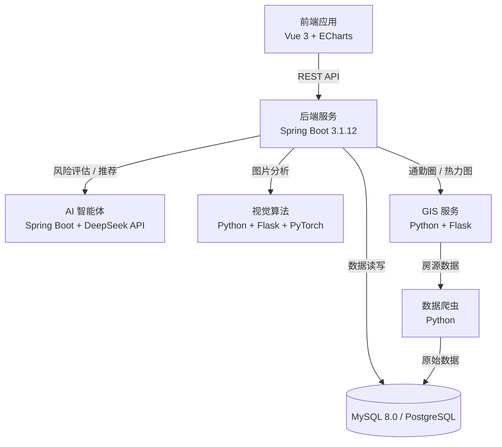
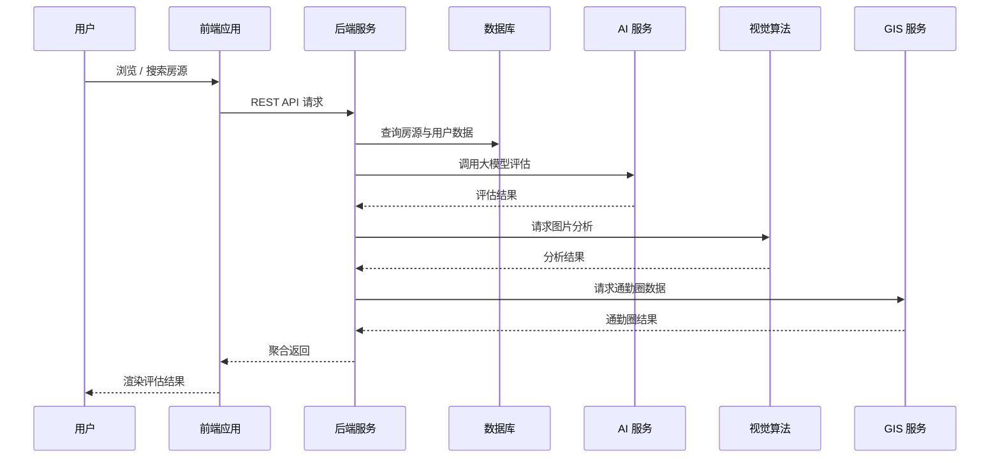

# 安居·罗盘

**基于 GIS 通勤圈与多模态 AI 的租房风险评估系统**

大学生计算机设计大赛参赛项目。面向租房用户，融合地理信息（GIS 通勤圈）、多模态 AI（大模型对话、图像视觉）与房源数据采集，提供房源风险识别、综合评估与个性化推荐的一体化解决方案。

---

## 项目简介

当前租房市场信息不对称、房源风险难以识别，用户在通勤成本、房屋质量、租赁安全之间难以权衡。安居·罗盘以"通勤圈 + 多模态 AI"为核心能力，实现：

- 基于 GIS 计算房源的通勤圈与职住平衡情况
- 基于视觉算法识别房源图片中的 P 图、盗图、甲醛房、装修质量等问题
- 基于大模型对话完成个性化推荐与租房风险问答
- 基于风控规则输出房源风险评分与评估报告

## 核心特性

- **GIS 通勤圈分析**：计算房源周边 30 分钟通勤圈、职住平衡比、热力图与居住风险数据
- **多模态 AI 评估**：OCR 文本提取、家具检测、盗图相似度检查、房间质量评估、伪造/AI 生成识别
- **智能对话助手**：基于大模型（DeepSeek）实现租房咨询、反诈检测与报告生成
- **个性化推荐**：结合用户画像与浏览行为生成房源推荐与推荐理由
- **风控报告**：多维度风险评分（风险等级、甲醛风险等）与可视化展示
- **数据采集**：爬虫采集真实房源数据，支撑模型训练与评估

## 系统架构



## 模块说明

| 模块 | 目录 | 职责 | 技术 |
| ---- | ---- | ---- | ---- |
| 前端应用 | `frontend/` | 页面交互、数据可视化 | Vue 3、Vue Router、ECharts 5 |
| 后端服务 | `backend/` | 业务接口、认证、风控报告 | Spring Boot 3.1.12、MyBatis-Plus、JWT |
| AI 智能体 | `ai-algorithm/ai-agent/` | 大模型对话、反诈检测、报告生成 | Spring Boot、DeepSeek API |
| 视觉算法 | `ai-algorithm/vision/` | OCR、家具检测、盗图检测、质量评估 | Python、Flask、PyTorch |
| GIS 服务 | `data-gis/gis-service/` | 通勤圈、热力图、职住比、风险数据 | Python、Flask |
| 数据采集 | `data-gis/crawler/` | 房源数据爬取 | Python |
| 数据库 | `database/` | 初始化脚本与数据备份 | MySQL |

## 技术栈

| 层 | 技术 |
| ---- | ---- |
| 前端 | Vue 3（CDN 引入）、Vue Router、ECharts 5、Font Awesome |
| 后端 | Spring Boot 3.1.12、Java 17、MyBatis-Plus 3.5.5、PostgreSQL（默认）、MySQL 8.0、JWT |
| AI 服务 | Spring Boot 3.1.12、Java 17、DeepSeek API（HTTP） |
| 视觉算法 | Python 3.9+、PyTorch 2.0+、EfficientNet / ResNet / Xception、Tesseract OCR |
| 数据与 GIS | Python、Flask、GIS 通勤圈计算 |
| 构建 | Maven（后端）、pip / conda（Python） |

## 快速开始

### 环境要求

- JDK 17 或更高版本
- Maven 3.6 或更高版本
- PostgreSQL（默认）或 MySQL 8.0
- Python 3.9 或更高版本
- 可选：支持 CUDA 的 NVIDIA GPU（视觉模型训练）

### 1. 初始化数据库

后端默认使用 PostgreSQL。`database/` 目录提供 MySQL 初始化脚本，可按需导入，并同步修改各服务配置中的数据库连接信息。

### 2. 启动后端服务（backend）

```bash
cd backend
mvn spring-boot:run
```

配置位于 `backend/src/main/resources/application.yml`，默认服务端口 8082。

### 3. 启动 AI 智能体（ai-algorithm/ai-agent）

```bash
cd ai-algorithm/ai-agent
mvn spring-boot:run
```

配置位于 `ai-algorithm/ai-agent/application.yml`，默认端口 8081。请将 `ai.api.key` 替换为有效的 DeepSeek API Key。

### 4. 启动视觉算法服务（ai-algorithm/vision）

```bash
cd ai-algorithm/vision/Vision
pip install -r requirements.txt
python main.py web --model-path models/saved/best_model.pth --model-name efficientnet_b0 --port 8080
```

### 5. 启动 GIS 服务与爬虫（data-gis）

```bash
cd data-gis/gis-service
pip install -r requirements.txt
python app.py
```

GIS 服务配置参考 `data-gis/gis-service/.env.example`。

### 6. 访问前端

```bash
cd frontend
```

前端为纯静态页面（Vue 3 通过 CDN 引入），直接使用浏览器打开 `index.html`，或通过任意静态服务器托管。

## 接口概览

### 后端服务（backend）

| 模块 | 接口 | 方法 | 说明 |
| ---- | ---- | ---- | ---- |
| 房源 | `/house/list` | GET | 获取所有房源 |
| 房源 | `/house/detail/{id}` | GET | 获取房源详情 |
| 房源 | `/house/page` | GET | 分页查询房源 |
| 房源 | `/house/search` | POST | 条件搜索房源 |
| 用户 | `/user/register` | POST | 用户注册 |
| 用户 | `/user/login` | POST | 用户登录（返回 token） |
| 用户 | `/user/info/{id}` | GET | 获取用户信息 |
| 收藏 | `/favorite/*` | - | 房源收藏管理 |
| 推荐 | `/recommend/*` | - | 个性化房源推荐 |
| 报告 | `/report/*` | - | 风险报告生成与查询 |
| GIS | `/gis-proxy/*` | - | GIS 数据代理转发 |

### AI 智能体（ai-algorithm/ai-agent）

| 接口 | 方法 | 说明 |
| ---- | ---- | ---- |
| `/ai/chat` | POST | AI 租房咨询对话 |
| `/ai/analyze-chat` | POST | 聊天记录分析（反诈检测） |
| `/ai/generate-report` | POST | 综合报告生成 |
| `/ai/health` | GET | 健康检查 |

### 视觉算法（ai-algorithm/vision）

| 接口 | 说明 |
| ---- | ---- |
| `/api/analyze` | 图片综合分析（OCR、家具、盗图、质量） |

## 业务数据流



## 目录结构

```
anjuluopan/
├── backend/                 # 后端服务（Spring Boot）
│   ├── src/
│   ├── pom.xml
│   └── README.md
├── frontend/                # 前端应用（Vue 3 + ECharts）
│   ├── index.html
│   ├── components/
│   └── house-images/
├── ai-algorithm/            # AI 算法模块
│   ├── ai-agent/            #   AI 智能体（Java / Spring Boot）
│   └── vision/              #   视觉算法（Python / Flask / PyTorch）
├── data-gis/                # 数据采集与 GIS 服务
│   ├── crawler/
│   ├── gis-service/
│   ├── data/
│   └── docs/
├── database/                # 数据库脚本
├── README.md
├── .gitignore
└── LICENSE
```

## 部署

### 后端

```bash
cd backend
mvn clean package
java -jar target/luopan-0.0.1-SNAPSHOT.jar
```

### 视觉算法（GPU 服务器）

```bash
cd ai-algorithm/vision/Vision
python main.py web --model-path models/saved/best_model.pth --model-name efficientnet_b0 --port 8080
```

### GIS 服务（Linux systemd）

仓库内置 systemd 服务单元：`data-gis/gis-service/gis_service.service`，可参考配置常驻运行。

## 参与贡献

1. Fork 本仓库
2. 新建功能分支（`Feat_xxx`）
3. 提交代码
4. 发起 Pull Request

## 开源协议

本项目基于 [MIT](LICENSE) 协议开源。
